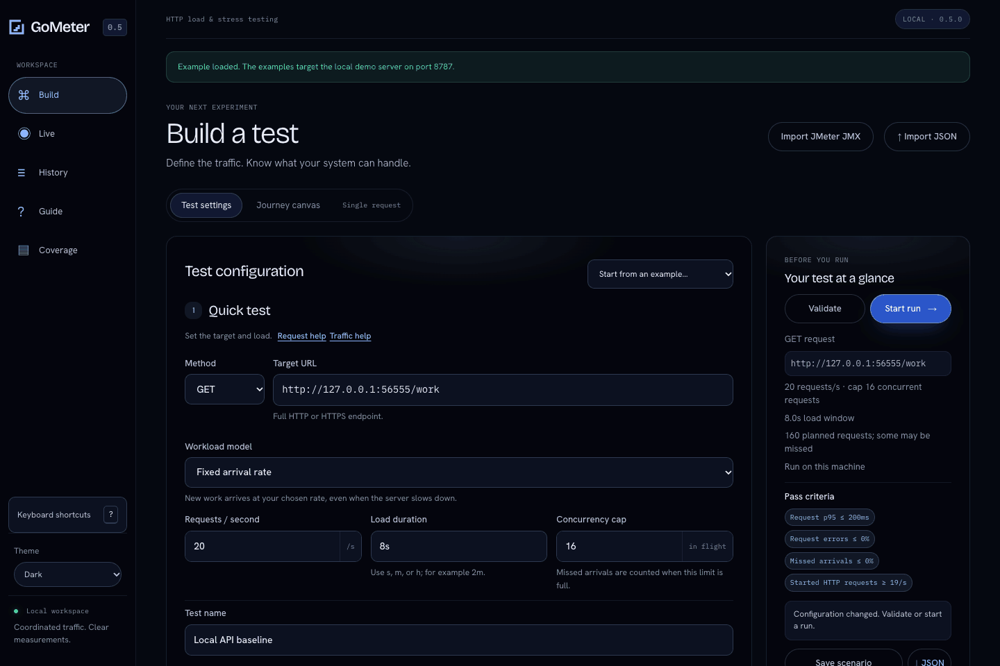
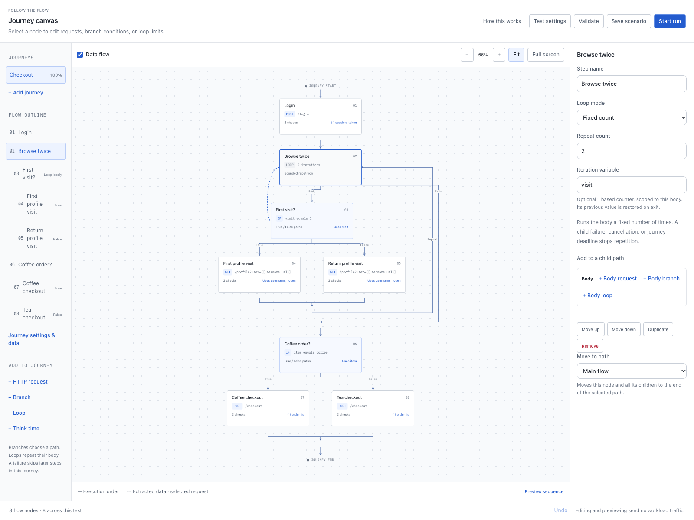
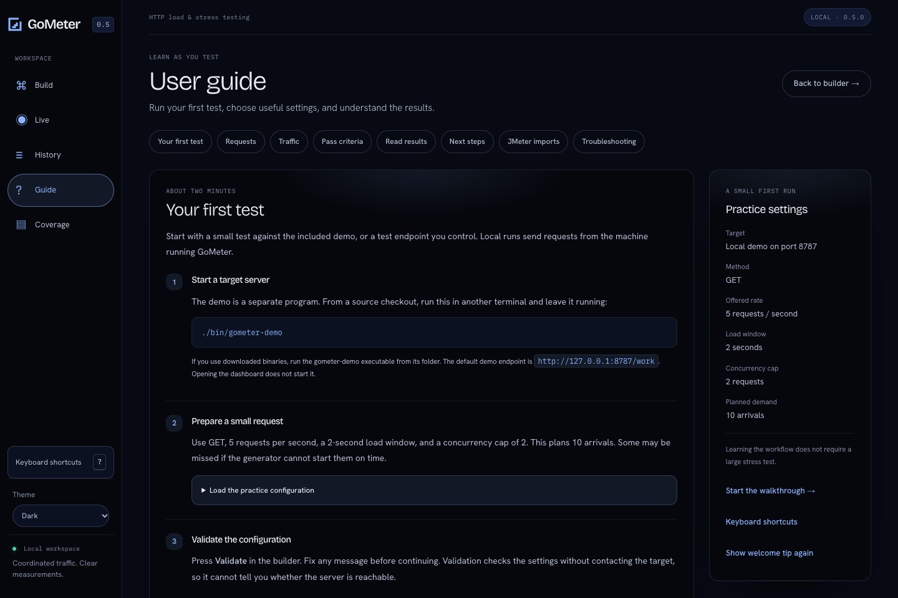

<h1><picture>
  <source media="(prefers-color-scheme: dark)" srcset="internal/design/assets/gometer-logo-dark.svg">
  
</picture></h1>

**HTTP load testing with a visual dashboard and CLI.**

Build tests, model application journeys, and inspect live results. GoMeter tracks
planned arrivals, delivered traffic, errors, and missed demand separately, so
missed traffic stays visible alongside latency.

A single Go binary includes the dashboard and starter configurations. No Java,
Node.js, or external frontend assets are required at runtime.

[Get started](docs/getting-started.md) · [Documentation](docs/README.md) ·
[CLI reference](docs/cli.md) · [Roadmap](ROADMAP.md)



## Quick start

Install **Go 1.27.3 or newer**, then build from a source checkout:

```sh
go build -o bin/gometer ./cmd/gometer
go build -o bin/gometer-demo ./cmd/gometer-demo
```

Alternatively, use `make build`. On Windows, add `.exe` to both output filenames.

Start the bundled demo:

```sh
./bin/gometer-demo
```

In another terminal, start the dashboard:

```sh
./bin/gometer ui
```

You can also set startup options through environment variables:

```sh
GOMETER_UI_LISTEN=127.0.0.1:8792 \
GOMETER_UI_DATA=work/environment-dashboard \
./bin/gometer ui
```

Explicit flags override environment values. See the
[environment reference](docs/cli.md#environment) for dashboard, worker, and
configuration-file settings.

Open the printed URL, normally **http://127.0.0.1:8790**, and select
**User guide → Your first test**. Load the practice configuration, validate it,
then select **Start run** to send traffic. Validation sends no workload traffic.

Scenarios and history default to `.gometer/`. Use `GOMETER_UI_DATA` or `-data`
to select another workspace. See [Getting started](docs/getting-started.md) for a complete walkthrough.

### Run from the CLI

With the demo running:

```sh
./bin/gometer validate -config examples/smoke.json
./bin/gometer run -config examples/smoke.json
```

The smoke test schedules 40 arrivals over two seconds. JSON and self-contained
HTML reports are saved under `results/`.

## Capabilities

| Area | Support |
| --- | --- |
| HTTP | HTTP/1.1 and HTTPS with HTTP/2 negotiation; custom methods, headers, bodies, status checks, and pooled connections |
| Traffic | Concurrent users, duration and iteration limits, ramp-up, startup delay, arrival rates, sequential phases, pauses, and seeded jitter |
| Visual journeys | Requests, nested branches and loops, cookies, variables, extraction, assertions, weighted mixes, and dependency links; [canvas guide](docs/dashboard.md#edit-a-journey-on-the-flow-canvas) |
| Test data | Inline data and CSV import with column mapping, shared or per-user rows, and end-of-file controls; CSV supports local users-mode journeys; [dataset guide](docs/datasets.md) |
| Checks and failure handling | Latency, error rate, missed demand, and minimum throughput checks; configurable user and test stop actions; [configuration](docs/configuration.md) |
| Authoring | Guided builder, starter tests, Advanced JSON, saved scenarios, and an in-app guide |
| JMeter import | Guided compatibility review and conversion of supported JMeter 5.6.3 HTTP plans; unsupported behavior blocks runnable conversion; [import scope](docs/jmx-import.md) |
| Results | Live charts, history, two-run comparison, JSON/HTML reports, and portable run bundles |
| Diagnostics | Generator resources, arrival delay, connection reuse, HTTP timings, and selected Prometheus exporter gauges and counters |
| Distributed runs | Reusable named worker catalog, manual connection checks, shared rate schedules, concurrency quotas, and incomplete-result detection; rate mode only; [worker guide](docs/workers.md) |

<details>
<summary>Screenshots</summary>

### Journey canvas

Edit requests, inspect extracted data, and reorder steps. Try the
**Authenticated checkout journeys** starter.


Use **Branches and loops** to explore nested control flow.
[Flow syntax](docs/scenarios.md#branches-and-loops).



### JMeter import

Review compatibility, provide properties, and save a native scenario or migration draft.


### Test builder

Configure requests, traffic, and acceptance checks before starting a run.


### Worker catalog

Register named load generators, inspect dated connection observations, and
select workers when building a test.


### Results

Review traffic, latency, errors, missed arrivals, and acceptance checks.


### User guide

Follow the first-test walkthrough or find help with settings and results.



</details>

Captures use the bundled demo and disposable local test fixtures. The measurements are examples, not benchmarks.
[Capture notes](docs/images/README.md).

## Measurement model

- **Demand:** scheduled arrivals are recorded as started work or capacity/scheduler
  misses. Missed work has no response-latency sample.
- **Units:** journey arrivals and HTTP throughput are separate. A three-step
  journey can produce three HTTP attempts.
- **Latency:** includes the full response body and completed failed attempts.
  Percentiles are bounded-histogram estimates.
- **Pass criteria:** a pass means the run completed and its configured checks
  passed. Review errors, missed demand, latency, and execution conditions together.

See [Measurement definitions](docs/measurements.md) before making capacity or
performance comparisons. No benchmark establishes a performance advantage over JMeter.

## CI usage

With the demo running, execute a test and retain reports even if checks fail:

```sh
./bin/gometer run -config examples/smoke.json -quiet \
  -out results/ci.json -html results/ci.html
```

| Exit code | Meaning |
| --- | --- |
| `0` | Completed; all checks passed |
| `1` | Checks failed, including incomplete distributed results |
| `2` | Input, setup, control, or report output error |
| `130` | Interrupted; partial reports attempted |

Stress and telemetry examples intentionally overload the demo and normally return
`1`. See [CI guidance](docs/cli.md#ci-usage) for exit codes and artifact handling.

## Documentation

| Topic | Guides |
| --- | --- |
| Setup and authoring | [Getting started](docs/getting-started.md), [dashboard](docs/dashboard.md), [configuration](docs/configuration.md), [CLI](docs/cli.md) |
| Journeys and migration | [Journeys](docs/scenarios.md), [CSV datasets](docs/datasets.md), [JMeter import](docs/jmx-import.md) |
| Results and diagnostics | [Measurements](docs/measurements.md), [diagnostics](docs/diagnostics.md), [telemetry](docs/telemetry.md) |
| Deployment and operations | [Workers](docs/workers.md), [Kubernetes](docs/kubernetes.md), [operations](docs/operations.md) |
| Security and adoption | [Security](SECURITY.md), [HTTPS](docs/https.md), [readiness](docs/readiness.md) |
| Development | [Contributing](CONTRIBUTING.md), [architecture](docs/architecture.md), [roadmap](ROADMAP.md) |

## Project status

GoMeter is in active development. The dashboard is single-user and listens on
loopback by default. Remote access requires a private authenticated ingress;
remote workers use a separate authenticated control plane. Review the
[readiness gates](docs/readiness.md) before enterprise adoption.

Distributed users, browser JavaScript execution, and non-HTTP adapters are not
supported. Recording and additional authentication options are planned. Full
JMeter parity is tracked in the [parity program](docs/jmeter-parity.md).

The repository has no LICENSE file. License selection remains a maintainer decision.

For development checks and builds, run `make check build`.
See [Contributing](CONTRIBUTING.md) for prerequisites and equivalent commands.
