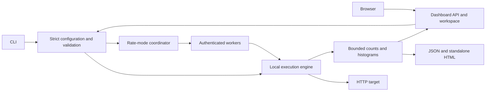

# Architecture

[Documentation](README.md) · [Project overview](../README.md)

The CLI and embedded dashboard use the same configuration, execution,
measurement, and reporting packages. The dashboard listens on loopback by
default; its optional remote mode is intended for a trusted private ingress.
Remote workers run the same engine against a coordinated rate schedule. The
demo is a separate local fixture service.

## Execution flow

This is a logical flow. Worker engines and their measurements run in separate
processes; final histogram states are validated and merged by the coordinator.
The diagram does not imply shared memory or a durable job queue.

## Package responsibilities

| Area | Responsibility |
| --- | --- |
| `cmd/gmeter/` | Signal-aware executable entry point |
| `internal/cli/` | Commands, overrides, setup, reports, and exit codes |
| `internal/config/` | Strict JSON input, defaults, validation, compiled plans |
| `internal/correlation/` | Variable encoding and JSON Pointer lookup |
| `internal/engine/` | Users/rate scheduling, concurrency, HTTP execution, journeys, sessions, and acceptance checks |
| `internal/metrics/` | Bounded histograms, counters, snapshots, and transfer-state validation |
| `internal/diagnostics/` | Generator CPU, memory, goroutine, and GC sampling |
| `internal/distributed/` | Worker authentication/control, reservations, shared scheduling, leases, and aggregation |
| `internal/telemetry/` | Bounded exporter parsing, selected scalar series, coverage, and counter/gauge observations |
| `internal/report/` | Portable result JSON and self-contained HTML |
| `internal/dashboard/` | Embedded app, local HTTP API, saved scenarios, runs, imports, and comparisons |
| `examples/` | Shared CLI examples and embedded dashboard starters |
| `cmd/gmeter-demo/` | Bounded-capacity HTTP target, journey endpoints, and telemetry exporter |

## Measurement and collection boundaries

- Workload accounting separates admitted requests/journeys from HTTP attempts,
  completions, failures, skipped steps, and missed arrivals.
- Generator diagnostics sample the process executing work. Dashboard work in
  that process can affect the observation; distributed resources stay per worker.
- Optional target telemetry is collected by the local process or distributed
  coordinator. Workers receive neither its configuration nor exporter token.
- Telemetry/control traffic is separate from workload counters and acceptance
  checks. Missing target samples do not become zero; missing worker results
  leave unknown traffic and fail completion checks.
- The dashboard retains bounded timeline windows while final aggregates cover
  the entire measured run. Individual response samples are not retained.

See [measurements](measurements.md), [workers](workers.md), and
[telemetry](telemetry.md) for the exact contracts.

## Persistence and trust

The dashboard owns files under its configured workspace, with atomic writes and
one active run per process. It is not a database service, multi-user server, or
cross-process coordinator. Workers hold jobs/results in memory and enforce a
lease; there is no persistent queue or automatic replay.

The frontend ships as embedded HTML, CSS, JavaScript, and the feature catalog.
There is no frontend toolchain or remote asset dependency. After changing those
assets, rebuild and restart the binary, then reload the browser.

For trust boundaries, credential handling, and artifact exposure, read
[SECURITY.md](../SECURITY.md). For backup and recovery, read
[operations](operations.md).
