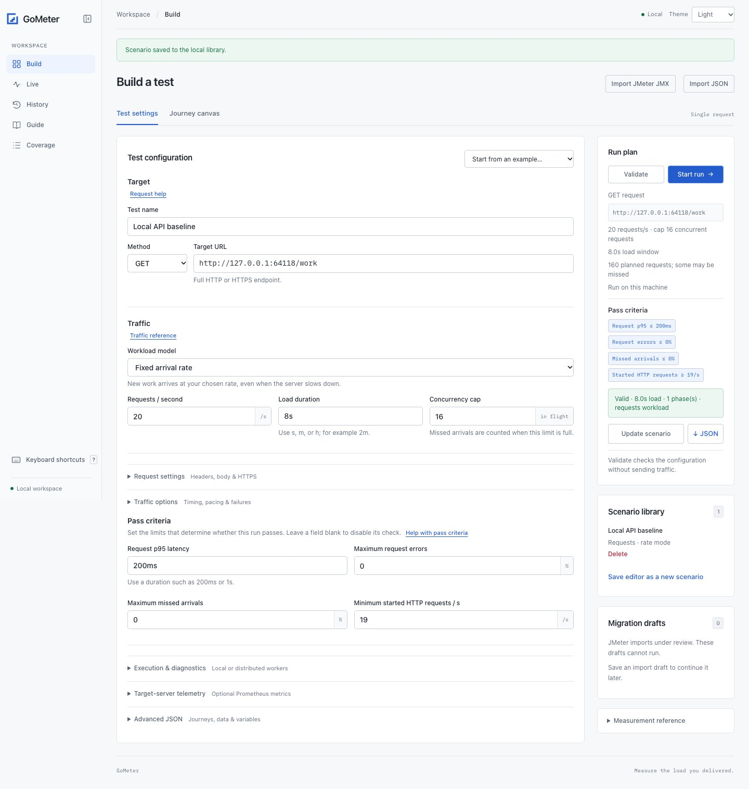
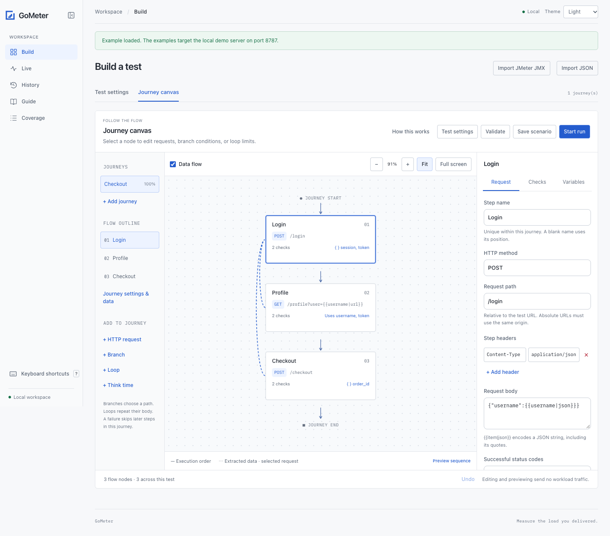
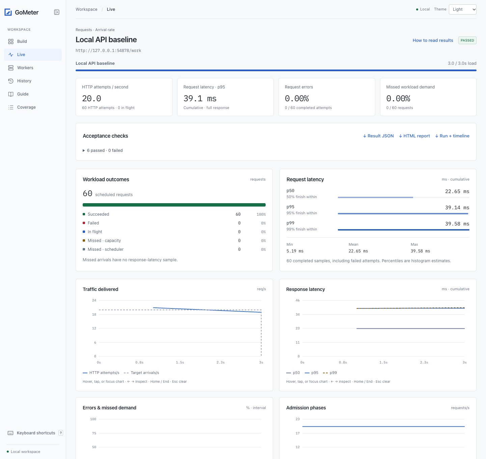

# Browser dashboard

[Documentation](README.md) · [Project overview](../README.md)

```sh
make build
./bin/gometer ui
```

Open the printed URL, normally **http://127.0.0.1:8790**. The binary includes the
app and seven starter configurations. Node and external assets are not needed.
Start `./bin/gometer-demo` separately to use examples on port 8787.

```sh
./bin/gometer ui -listen 127.0.0.1:8791 -data /path/to/workspace
./bin/gometer ui -listen '[::1]:8790'
```

The listen address must be an explicit IP and port. Loopback is the default;
port `0` selects an available port. A non-loopback listener requires
`-public-origin https://host` and must sit behind a private TLS ingress that
enforces VPN access or authentication and an allowlist. The default data
directory is `.gometer/` in the current directory. See [private ingress access](operations.md#private-ingress-access).

With a current-source binary, the equivalent startup can use environment
variables and leave the command as `gometer ui`:

```sh
GOMETER_UI_LISTEN=0.0.0.0:8790 \
GOMETER_UI_PUBLIC_ORIGIN=https://gometer.example.internal \
GOMETER_UI_DATA=/data \
./bin/gometer ui
```

Use an existing writable directory for `/data`, or a PVC in Kubernetes. NGINX
terminates browser HTTPS and forwards HTTP to port 8790; the dashboard pod needs
no server certificate. Worker tokens and worker CA files are needed only when
using remote workers. Leave **Workers** blank to execute on the dashboard host.
See the [dashboard-only Kubernetes deployment](kubernetes.md#start-the-dashboard-without-workers)
and [environment reference](cli.md#environment). Explicit flags override these
variables, and environment changes require a process restart. The current prefix
is `GOMETER_*`; `GMETER_*` names are not read.

## App overview



For a first test, follow [getting started](getting-started.md) or open **Guide**
in the app. See [operations](operations.md) for workspace ownership, retention,
backup, and recovery, and [security](../SECURITY.md) for trust boundaries.
Use **Theme** in the workspace sidebar to follow the system appearance or select
Light or Dark. The choice is saved in this browser.

## Keyboard shortcuts

Choose **Keyboard shortcuts** in the sidebar (on small screens, open **More**),
or press **?** outside a text field. The reference shows keys for your platform.

| Keys | Action |
| --- | --- |
| G, then B | Build |
| G, then L | Live results |
| G, then H | Run history |
| G, then G | User guide |
| G, then C | Feature coverage |
| ⌘/Ctrl + Enter | Validate the current builder configuration without workload traffic |
| ⌘/Ctrl + S | Save/update the current scenario |
| ⌘/Ctrl + Shift + Enter | Start a run using the current builder settings |
| ⌘/Ctrl + Z | Undo a canvas edit when focus is outside a text field |
| Escape | Close a dialog or cancel a pending G sequence |

Release G before pressing the destination key within two seconds. A brief hint
shows the destinations. Navigation preserves the editor and focuses the new
view's heading. Builder actions are available only in Build and use the same
validation and active-run checks as their buttons. A valid inspector field is
settled before save/validate/start, just as when clicking the action.

Text fields, selects, editable content and open dialogs suppress character-key
shortcuts. Text undo and other standard editing/browser shortcuts stay native.
IME composition and held-key repeats do not dispatch app actions. In the
reference, turn off **Enable G sequences and ?** to disable character shortcuts;
this preference is saved in the browser. Modifier shortcuts remain available.
The character-key opt-out follows the [W3C guidance](https://www.w3.org/WAI/WCAG22/Understanding/character-key-shortcuts.html).

## Build and reuse tests

The form edits target, model, stopping condition, duration, iterations per user,
rate or users, concurrency cap, timeout,
arrival spacing, diagnostics, and optional target-server telemetry. **Advanced JSON** supports every CLI configuration field,
including headers, bodies, phases, data rows, journeys, assertions, and thresholds.
See [scenarios.md](scenarios.md) for journey syntax.

### Edit a journey on the Flow canvas



Load **Authenticated checkout journeys** from the starter menu to open the
**Journey canvas**, or open that tab and choose **Create journey from current
request**. **Test settings** holds the base URL, traffic model, defaults, and
request pass criteria. Both tabs and Advanced JSON edit the same CLI configuration.

1. Select a request card or its entry under **Flow outline**. The inspector
   edits its method, path, headers, body, successful statuses, and pause after
   success. Test headers are inherited; step headers override matching names.
2. Open **Checks** to add JSON Pointer, response-header, or body-content
   assertions. Open **Variables** to extract JSON values or response headers
   and see which variables are available before that request.
3. Enable **Data flow** to trace extracted variables used by the selected
   request. Solid arrows show execution order; dotted links show data dependencies.
   Drag a request onto another to place it at that position, or use **Move up**
   and **Move down**. Missing variables are flagged after reordering. **Undo**
   restores prior canvas edits within the current test (up to 20 edits).
4. Select **Journey settings & data** to edit the name, mix weight, variables,
   dataset rows, timeout, and journey pass criteria. Add or duplicate journeys
   to build a weighted mix. Dataset rows contain string values with identical keys.
5. Use **Preview sequence** for a traffic-free walkthrough; **Preview failure
   here** illustrates the selected failure action. It does not simulate
   responses or assertion outcomes. **Validate** performs authoritative engine
   validation. Save the scenario, then explicitly choose **Start run**.

Drag the background to pan; use the zoom buttons, Ctrl/Command + scroll, **Fit**,
or **Full screen** to navigate. Keyboard users can tab through request cards and
activate them with Enter/Space. The inspector provides all reordering controls.
Selection, zoom, and positions never change execution or appear in exported JSON.

Unfinished inspector fields block saving, validation, export, and starting. Fix
them or use Undo; switching the main authoring tab preserves the draft. Loading
a different starter, library entry, or valid Advanced JSON replaces the canvas
draft and clears its undo history. Changing Test settings also clears canvas undo
history so Undo cannot overwrite newer traffic settings. Save work before
replacing the test or reloading.

Use **+ Branch** for a conditional True/False split or **+ Loop** for a repeated
body. Select a control card to edit its condition or repeat count. Child-path
buttons add requests, branches, or loops inside it; **Move to path** moves any
node and its children into another path. Dragging onto a node also supports
moving between paths. **Move up/down** changes order among siblings.

Choose **Fixed count** to repeat 1–1000 times, or **While condition** with a
required maximum. While checks before each iteration, and fails with
`loop_limit` if still true after the maximum; use an extraction to update the
condition variable. **Iteration variable** is an optional 1 based counter scoped
to the body. Both controls can be nested. Validation checks every path and rejects
excessive iteration products or unavailable variables. See [flow semantics](scenarios.md#branches-and-loops).

Load **Branches and loops** for a complete local-demo example: login, two profile
visits with a nested condition, then checkout chosen by the data row. Its 20
journeys produce 80 HTTP attempts when successful. Structure previews show both
paths and loop bodies once; runtime responses decide execution, so failure
simulation is offered only for sequential flows. No preview sends traffic.

Think time belongs to the preceding request and runs only after that request
succeeds, including after the final step. Standalone pause nodes remain unsupported.

After a journey run finishes, **Journey results** shows the actual per-step
p95, error rate, failure counts, and skipped requests. Select **Journey summary**
for whole-journey measurements. No latency is shown when there are no samples;
step p95 values cannot be summed into journey p95. The diagram is read-only. Branch cards show True/False decisions and loop cards
show body iterations. Request attempts can exceed reached journeys inside loops.
Skipped journeys never attempted that node; the inspector distinguishes conditional
bypasses from the total. Controls have no HTTP latency.

Both editors update the same configuration. With phases present, their rates
and durations control the workload; the single-duration/rate fields are hidden.
**Use a single rate** removes phases and sets a rate of 20/s. Switching to users
mode removes rate phases and jitter; switching to rate mode removes think time,
user ramp, startup delay, and iteration limits.
Journey tests label rates as journeys/second and put HTTP methods on steps.

**Validate** uses the strict parser and engine validation without sending traffic.
Starting a run validates again. Unknown fields and trailing JSON are rejected.
Configuration imports have the same 1 MiB limit as the CLI.

**Workers** accepts origins on separate lines. An empty field executes locally;
worker pools support fixed arrival rates and use the configured rate/concurrency
as fleet totals. The dashboard must inherit `GOMETER_WORKER_TOKEN` at startup.
Remote origins require HTTPS. See [workers.md](workers.md) for worker setup,
clock estimation, fixed quotas, leases, and incomplete measurements.

**Target-server telemetry** configures a Prometheus text endpoint, cadence,
timeout, selected scalar series, and optional environment bearer authentication.
Leave the endpoint blank to disable it. Invalid selected-metrics JSON blocks
validation, saving, and starting until corrected. The new server telemetry
starter uses the rebuilt demo's `/metrics` endpoint. The dashboard reads
`GOMETER_TELEMETRY_TOKEN` and optional `GOMETER_TELEMETRY_CA` at startup; their
values do not enter browser payloads or exports. See [telemetry.md](telemetry.md).

**Save scenario** creates a library entry. After loading it, **Update scenario**
changes that entry. **Save editor as a new scenario** makes a separate copy.
**Import JSON** loads a validated configuration without saving or executing it.
**JSON** exports the current editor, preserving `null` for disabled checks.
Exports validate the editor first and use a native browser download. The server
retains at most 16 temporary configuration exports for five minutes in memory.

## Guided JMeter import

Choose **Build → Import JMeter JMX** to review a `.jmx` file, supply literal
property inputs, inspect compatibility details, and preview its journey.
The converter targets a limited subset of JMeter 5.6.3 HTTP plans. All blockers
and required inputs must be resolved, and runtime policies accepted, before
**Save scenario** becomes available. Saving and previewing send no traffic.

Blocked plans can be saved under **Migration drafts**, below the Scenario
library. They cannot run. A saved converted scenario retains its source through
**Review original JMX**; later builder edits do not change that original XML.
See the [import guide](jmx-import.md) for supported settings, runtime differences,
storage, and the sample walkthrough.

## Live measurements



Only one dashboard run can be active. Independently started CLI processes are
not coordinated with the dashboard, though each worker rejects a second active
reservation. Closing or reloading the browser does not stop a run: it belongs
to the dashboard process. Reopening reconnects to the current run. **Stop run**
cancels admission and active requests and saves partial results. Ctrl+C or SIGTERM
on the dashboard also cancels and saves before exit.

Charts refresh about once per second. Short runs still get initial/final samples.

- Traffic lines divide changes in started counters by wall time between samples.
  Journeys show both HTTP attempts/s and journeys/s; their target is journeys/s.
- Interval error percentages use failed/completed differences; missed-demand
  percentages use dropped/scheduled workload differences. No denominator means
  no point.
- Latency p50/p95 lines are cumulative histogram estimates, not interval
  quantiles. Cumulative quantiles cannot be subtracted to get interval quantiles.
- Cards use cumulative metrics and load-window throughput, matching the CLI.
  Interval charts use wall time and can show HTTP steps during journey drain.
- The phase chart shows the configured admission schedule (or user count).
  Live phase labels follow the current admission phase, then drain. Previously
  admitted journeys can still send steps after a phase transition.

The timeline retains the latest **900 samples**, roughly 15 minutes. Final
aggregates cover the whole run. No individual response samples or bodies are
stored. When diagnostics are enabled, the generator panel shows process CPU,
Go heap and runtime memory charts, resident-memory lifetime peak, goroutines,
GC, and workload arrival delay. The HTTP panel shows interval quantiles, sample
counts, connection reuse, protocols, and failures. A missing interval sample is
displayed as a dash. Older runs and runs with diagnostics disabled show a
message explaining that diagnostics were not recorded.

CPU charts show the last sampling interval; finished cards show the run average.
100% means one CPU core. Generator measurements include dashboard work in the
same process. Resident peak includes earlier runs, while Go heap and runtime
peaks cover the current sampled window. These are generator measurements, not
target-server telemetry. See [diagnostics.md](diagnostics.md) for the contract.
Distributed runs show worker status, assignment coverage, and per-worker CPU/heap
summaries. Global counts use only received final results when workers are lost;
the incomplete-worker warning remains visible even if measured errors are zero.

The telemetry panel shows scrape coverage, per-series values/issues, and a
selectable sampled-gauge or observed-counter-rate chart. Finished views add
whole-run summaries and use the collector's latest 900 full scrape observations;
live polling can skip intermediate scrapes. Missing values break the line; zero
is a valid measurement. Counter resets and gaps exclude unknown increases.
Telemetry requests are excluded from workload counters and load checks.

## History and portable files

Finished and interrupted runs persist across restarts. Each stores configuration,
final results (schema 3 locally, schema 4 for workers, schema 5 with telemetry; schema 6 for branches/loops),
and its retained timeline. If the process ends before
final persistence, its reservation appears as **abandoned** at the next startup.
That run is incomplete and cannot be resumed or compared.

Select two runs to compare target, workload, counts, throughput, latency, errors,
missed demand, and available timing and resource diagnostics. Differences are B minus A, with relative changes when A is
nonzero. Percentages differ in percentage points. Different conditions and
partial runs, diagnostics instrumentation, telemetry settings, and generator environments are flagged. Comparison is descriptive, without an automatic
regression verdict.

| Download | Contents | Importable |
| --- | --- | --- |
| Editor JSON | Reusable configuration | Yes |
| Result JSON | Same schema 3/4/5/6 measurements as the CLI | No; configuration is absent |
| HTML report | Standalone report | No |
| Run + timeline | Configuration, final results, retained timeline | Yes |

Use **Import JSON** or **Import run** for run bundles. Imports require final
schema 2–11 results, validate configuration, final count equations, and telemetry
observation bounds/accounting when present, have a 16 MiB
limit, and assign a new ID. They send no traffic. Imported runs are marked
**IMPORTED**; their original traffic has not been independently verified.
Importing the same file twice makes two history entries. CLI result JSON alone
is not a run bundle.

The workspace supports 200 saved scenarios and 1000 runs. Export entries before
deleting them if needed. If final persistence fails, the current result remains
available for export and new runs are blocked until the process is restarted.

## Access and storage

The server accepts its exact startup host and rejects cross-site origins. API
requests require a random startup token from the page. Native downloads use an
HttpOnly, SameSite=Strict session cookie restricted to download paths; it cannot
authorize API mutations. Tokens never appear in download URLs. A restrictive
content security policy protects the app, and user-provided names render as text.

Saved files are atomic and owner-readable (0600); new workspace directories use
0700. Existing directory permissions are not changed. Saved configurations and
run bundles include supplied headers, bodies, and data rows, which can contain
credentials. Result JSON and HTML omit headers and bodies but include target URLs.

This is a single-user app without accounts, RBAC, tenant isolation, audit log, or
encryption at rest. Private ingress access does not add those controls. Traffic
is sent only after explicitly starting a run. A fair comparison against JMeter
remains a later milestone.

## Guided builder and coverage audit

The builder keeps method, target, workload model, rate or users, duration,
concurrency cap, and test name together under **Quick test**. **Request settings**
expose header rows, a raw body, success status codes, and the
[insecure HTTPS option](https.md). **Traffic options** hold phases, timeout,
and arrival spacing; phases support add/remove controls and zero-rate pauses.
Blank pass criteria disable their checks; explicit zero remains a zero limit.
The preview distinguishes planned arrivals from actual work and explains
users-mode throughput. On phones, the compact summary stays above Validate and
Start run at the bottom of the screen. Optional worker, diagnostic, and
telemetry settings fold away. Advanced JSON remains available for all CLI
fields; the Journey canvas also edits steps, data, variables, and per-journey
criteria.

Invalid form drafts block validation, saving, export, and execution rather than
using an older serialized configuration. Editing valid JSON repopulates the form.
Run checks and downloads appear before diagnostic charts. Run history supports
name/result search, and changing views clears stale status notices.

**Coverage** is a searchable comparison against bundled JMeter 5.6.3,
with available, partial, and not-available families and official manual links.
The [parity program](jmeter-parity.md) defines the backlog and completion gates.
Backlog rows do not enable features.

## In-app user guide

**Guide** is in the sidebar on desktop and under **More** on phones. It covers a first local test,
requests, traffic models, pass criteria, interpreting results, reusable workflows,
and troubleshooting. Help links in Quick test and beside Pass criteria, Results,
and History open the relevant topic. Guide shortcuts return to the matching
builder field while preserving its current draft.

The walkthrough can load a practice configuration: GET to the demo on port 8787,
5 requests/s for 2s, concurrency 2, request timeout 1s, p95 limit 200ms, and no
allowed request errors or missed arrivals. This plans 10 arrivals. Loading
replaces only the editor draft after an explicit button click; it does not save
a scenario, start the demo, or send workload traffic. The user must start the
demo separately, Validate, then Start run.

A welcome tip introduces the guide. Hide tip remembers a browser-local
preference; User guide remains available. Show welcome tip again restores it.
If browser storage is unavailable, the guide still works and the tip may return
on the next visit. The guide does not mark a test complete just because the
user opened a topic or loaded a preset.

## Finite users runs

Open **Build a test → Test settings → Quick test**, choose **Concurrent users**,
then choose **Stop condition**: duration, iterations per user, or whichever limit
comes first. The preview shows the total planned or maximum attempts. For
example, 10 users × 5 iterations is 50 request or journey attempts. Errors count
as attempts. Live progress shows completed attempts against that target, and
finished runs show their stop reason. A duration-limited result can stop below
the count target. Iterations are unavailable in rate mode.

Schema 7 bundles retain these settings and validate the count and stopping
reason on import. Existing schema 2–6 bundles remain supported.

## User ramps and startup delay

Under **Test settings → Concurrent users → Traffic options**, set **Startup
delay** and **User ramp-up**. Blank or `0s` starts all users immediately. The
preview shows the first/last planned start and warns when duration will close
before every user starts. **Gradual users with finite iterations** is a built-in
example. Loading or validating the example sends no traffic.

During startup, Live shows **Waiting to start**, zero load seconds, and no
workload attempts. Afterward, it shows active users and total started users.
**User schedule** overlays planned starts (gray) and observed active users
(blue). Planned starts accumulate; active users can fall as finite users finish.
The observed line is sampled about once per second and can miss short activity.
Plans above 200 users use a simplified 200-point preview. This is a user lifecycle
chart, not HTTP concurrency or a target request rate.

Final schema 8 bundles preserve startup waiting separately from load and drain,
with user counts and schedule timeline validation. Existing schema 2–7 bundles
remain supported. A duration-limited run can pass while later users never start;
unstarted future work is not dropped demand. Worker execution remains rate-only.

## After a failed request

In **Concurrent users** mode, open **Traffic options** and choose **After a
failed request**. **Start next iteration** skips the rest of that journey.
**Continue journey** attempts later steps and loop iterations while retaining
failed request and journey counts. **Stop this user** ends only that user's
current journey and future iterations; peers continue. The plan preview shows
the action and the mandatory stopped-user criterion when applicable.

The journey inspector and simple sequence failure preview follow this setting.
Previews send no traffic and cannot predict responses, missing variables, or
branch decisions. Journey deadlines and safety limits still abort a journey.
Failed verification publishes no extracted values.

Live and final results show the selected custom action and users stopped on
error. A stopped user fails the run even with disabled error thresholds. History
comparison flags a different failure action. Schema 9 run bundles preserve the
policy and validate its counts and timeline on import; older schemas remain
supported. See [configuration](configuration.md#failure-actions) for details.

## Test-wide error stops

Under **Concurrent users → Traffic options → After a failed request**, choose
**Stop test gracefully** or **Stop test immediately**. Graceful ends the failing
journey, closes new users and iterations, and drains other admitted journeys.
Immediate cancels their requests and pauses as well. Future ramp starts are
canceled by both. The preview explains the policy and shows the mandatory
**Test must not stop on error** criterion.

Live results show the error stop while graceful work drains, with a frozen load
window. Final results identify graceful/immediate error stopping and keep partial
request, journey and user counts. These stops fail the run even when error
thresholds are disabled. Manual **Stop run** still cancels a graceful drain and
records an interruption; it does not erase the error stop.

New policies use schema 10 bundles, with a monotonic `test_stopped` flag and a
mandatory matching check. Older policies and schemas retain their formats.

## Import CSV journey data

Select **Concurrent users** in Test settings, then open **Journey settings & data → Import CSV dataset** on the canvas. Review column mappings and sample rows before applying. Choose shared or per-user rows, with recycling or normal user completion at EOF. The dialog preserves the current test until **Use dataset**; Undo restores a replaced inline dataset. Saved scenarios carry their data to another workspace. Live/final results show row assignments and users finished at EOF. See [CSV datasets](datasets.md) for complete rules and limits.
