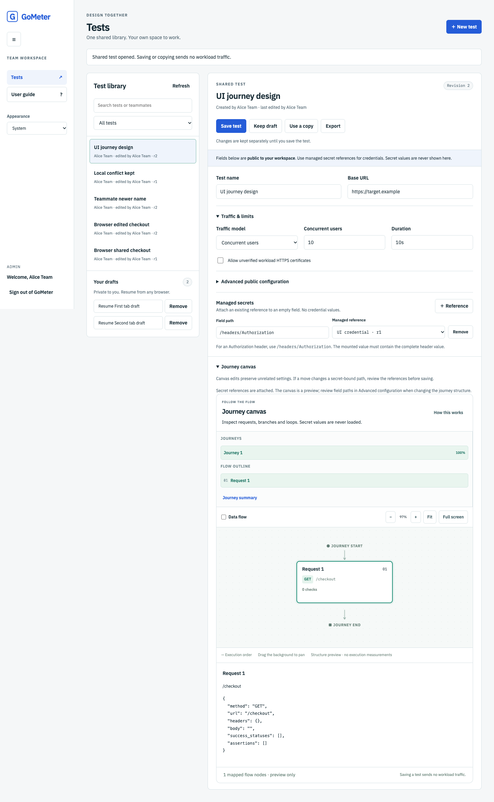

# Shared Tests editor and private drafts

[Documentation](README.md) · [Team setup](team-workspace.md) · [Shared documents](shared-tests.md)

Status: local implementation, 25 October 2026. Sign in to the configured
`gometer workspace serve` HTTPS origin to use this editor. The personal
`gometer ui` dashboard remains independent. This milestone supports shared
authoring; it does not provide team execution or a run queue yet.

The screenshot uses disposable local fixtures and demonstration data.

## Create or inspect a test

1. Open **Tests**, then choose **New test**. Viewers may inspect and export existing
   shared tests; operators and administrators may create and edit them.
2. Enter a name and base URL. Choose a method and optional public request body.
3. Choose concurrent users or arrival rate, demand and duration. Advanced schedules
   and iteration counts remain intact; use **Advanced public configuration** to
   change settings that cannot be represented by the simple traffic form.
4. Attach credentials with **Managed secrets → Reference**, using an enabled
   catalog reference and the destination field's path. For an Authorization header,
   use `/headers/Authorization`. The entire mounted header value, including its
   scheme, belongs in the secret source; no value is shown or entered here.
5. Choose **Save test** to publish the configuration to the shared library, or
   **Keep draft** to retain work privately.

Every value in the public configuration is eligible for workspace read/export.
This includes request bodies, dataset text and query values. A reference-bound
field must be empty; the editor can create an empty root header/body slot for a
new binding. Other paths must point to existing empty fields in Advanced
configuration. Literal standard credential headers are rejected by the backend.
Application-specific sensitive data still requires correct author classification.

The library supports **All tests**, **My tests**, and search by test or teammate
name. It displays creator, last editor and revision. **Use a copy** creates an
independent saved identity with provenance. **Export** downloads the saved public
document and reference IDs; unpublished editor changes are excluded.

Older native definitions remain private. Selecting one explains the boundary
without returning its original URL, headers, body or dataset. Review its fields
separately and create an explicitly classified shared document.

## Journeys and managed paths

Expand **Journey canvas** to reuse the existing flow editor for public-only tests.
Create a journey from the current request, then inspect and edit request nodes,
branches and loops. The canvas preserves unrelated native configuration fields.
No **Start run** action is mounted in team mode. Validation checks native settings
and current references without reading secret files or contacting targets.

Bindings use positional paths such as `/scenarios/0/steps/1/headers/Authorization`.
Moving a node could move the meaning of such a path. When a test has managed
bindings, the canvas becomes a preview; use Advanced configuration and review the
paths explicitly when changing structure. This is a deliberate editor limit until
secret targets have stable identities through structural canvas edits. Previewing
an ordinary one-request test does not rewrite its saved configuration.

## Keep work and recover after a restart

Valid changes are saved to a private draft after a short pause. **Keep draft**
requests an immediate save. Wait for **Private draft saved** before relying on
recovery, then resume it under **Your drafts** after reloading or signing in from
another browser. Drafts belong to the verified actor within the configured
workspace: other members, including administrators, cannot read or change them
through the application API.

PostgreSQL migration 005 adds drafts. Each actor may retain ten per workspace;
there is no automatic expiry or silent eviction. Remove an old draft to free
space. The bound is independent of queue capacity. Draft lists contain metadata;
only an individual authorized read selects the document.

Drafts contain validated public configuration and reference IDs/revisions, never
mounted values. References may become stale or disabled while editing; the draft
remains recoverable, while publishing still requires current enabled references.
An old base revision is retained for honest conflict detection.

Invalid JSON, incomplete references or unfinished canvas fields cannot be stored
as recoverable drafts. They stay in the current tab, with a navigation/reload
warning. Correct them before choosing **Keep draft and continue**, or explicitly
discard them. No workload document or token is written to browser local/session
storage. A browser crash can lose unfinished invalid text.

After a successful test save, the editor removes its matching private draft.
These are separate conditional operations: if cleanup fails, the test remains
saved and the UI explains that the draft still needs review. It does not retry
the publication as though it had failed.

## Resolve conflicts without overwriting work

If another author saves first, GoMeter retains your local document and original
base revision. Compare it with the latest saved version, keep a private draft,
save your edits as a new test, or keep the draft and reload the saved version.
There is no automatic merge or force-overwrite operation.

If two tabs edit the same draft, one conditional save wins. The other tab keeps
its text and can **Keep a separate draft**. Removing a draft also requires its
exact revision. Source mapping changes require explicitly choosing a current
reference; the editor never silently upgrades a pinned credential mapping.

Backend membership checks remain authoritative. A role change can remove write
permission from an existing session. An account change in another tab locks the
old workspace view and clears its private draft content; late old responses are
discarded. Reload to open the new account's workspace.

## Navigation and shortcuts

The builder stays within Tests. Collapse the sidebar for more room, choose
Light/Dark/System appearance, or open **User guide** for the first-test steps.
Layouts adapt to narrow screens without hiding request values. Preferences are
local to the page in this milestone; reload restores system appearance.

| Shortcut | Action |
| --- | --- |
| Ctrl/Command + S | Save the open shared test |
| Ctrl/Command + Shift + S | Keep a private draft |
| ? outside an input | Open the user guide |
| Escape | Close an open dialog |

## Verification boundary

The disposable PostgreSQL suite verifies ownership, current-role checks,
conditional updates/deletes, independent connection races, audit rollback, bounds
and migration preservation. Chromium covers real form edits, reload recovery,
two-tab test/draft conflicts, managed-reference previews, canvas edits, viewer
access, account changes, downloads, sidebar/themes and four widths in two color
schemes. These fixtures use local OIDC and fake public targets. They do not prove
company Keycloak/LDAP configuration, Kubernetes deployment or executor behavior.
