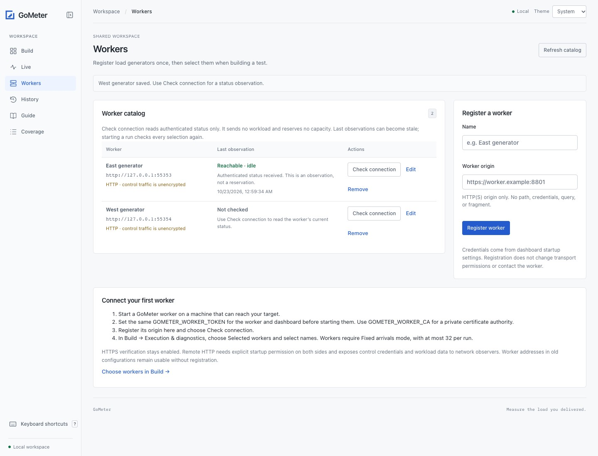

# Distributed workers

[Documentation](README.md) · [Project overview](../README.md)

Authenticated worker processes and a coordinator support
**rate-mode** tests. Single requests, journeys, weighted mixes, seeded jitter,
and sequential phases use the same engine. Users mode currently runs locally.

## Local setup

Build with `make build`. Generate one token and securely provide the same value
to each worker and coordinator through `GOMETER_WORKER_TOKEN`. It must contain
32–512 ASCII characters without whitespace. You can generate a value once with
`openssl rand -hex 32`; do not generate different tokens for each process.
Worker-control tokens are never stored in configurations, reports, or exported
bundles. Supplied workload headers, bodies, and data remain part of saved
configuration; see [security](../SECURITY.md).

With that environment variable set in each terminal:

```sh
# Terminal 1: target service
./bin/gometer-demo

# Terminal 2: first worker
./bin/gometer worker -name worker-1 -listen 127.0.0.1:8801

# Terminal 3: second worker
./bin/gometer worker -name worker-2 -listen 127.0.0.1:8802

# Terminal 4: coordinator
./bin/gometer run -config examples/smoke.json \
  -workers http://127.0.0.1:8801,http://127.0.0.1:8802

# Or use the browser dashboard as the coordinator.
./bin/gometer ui
```

In the dashboard, open **Workers** in the sidebar and register each generator
with a name and its HTTP(S) origin. Then open **Build → Execution & diagnostics**,
choose **Selected workers**, and select names. Choose **This machine** for local
execution. The **Distributed local smoke test** starter also loads worker origins.
The dashboard must inherit its token when it starts; changing another shell's
environment cannot update an already running process.

## Reusable worker catalog



The catalog is shared by browsers connected to the same dashboard. Up to 200
entries are stored under `workers/` in the configured workspace
(`-data` / `GOMETER_UI_DATA`) using atomic writes. Each entry has a stable ID,
name, origin, and optional dated connection observation. Refresh catalog reads
saved entries without contacting workers. Back up the workspace to retain them.

Register an origin such as `https://worker.example:8801`, without a path,
credentials, query, or fragment. Equivalent origins, including hostname case,
trailing slash, and default ports, cannot be registered twice. Editing keeps the
entry ID; changing its origin clears its previous connection observation.
Registration does not start a process, contact a worker, or grant permission to
use HTTP. Worker tokens and private CA configuration remain startup settings;
there are no credential fields in catalog entries or exported configurations.

**Check connection** makes one authenticated backend `GET /v1/info` request. It
sends no target traffic and creates no reservation. The UI distinguishes:

| Observation | Meaning |
| --- | --- |
| Not checked | No observation for this origin |
| Reachable · idle | Supported authenticated worker status received; no reservation reported |
| Busy | Worker reported a reservation or active run |
| Unreachable | Connection, DNS lookup, or timeout failed |
| Authentication failed | Startup token is missing/invalid, or the worker rejected authentication |
| TLS / transport failed | Certificate/CA, transport, or remote HTTP permission needs attention |
| Incompatible response | Address did not return the supported GoMeter worker status format |

A timestamp records when the observation finished. It can become stale and
remains dated after dashboard restart. A reachable observation is not a promise
of capacity, target connectivity, clock synchronization, or future availability.
Validation stays offline. Starting a run performs the existing preflight and
reservation against **every** selected origin. It never silently skips a selected
worker or changes execution to local when a worker fails.

Configurations still store `workers` as an array of origins. Loading an old
scenario, imported configuration, draft, or historical run preserves its exact
origins. Unregistered or removed entries appear as **From this configuration**
and stay selected; **Register** is an explicit action. Editing/removing a catalog
entry does not rewrite existing configurations or change active runs. Choose a
new entry or deselect the old origin explicitly when changing a test.

A new dashboard run captures the selected origins plus available catalog IDs and
names in `worker_snapshots`. History and Run + timeline bundles retain that
identity even after catalog changes. Older bundles without this optional metadata
remain importable. Importing a bundle does not register workers. The CLI continues
to accept origin arrays independently of the dashboard catalog.

Each distributed run supports at most 32 workers, in **Fixed arrivals** mode,
with at least one concurrency slot per worker. Empty worker selections block
builder actions until a worker is selected or **This machine** is chosen. Catalog
size is separate from the per-run limit. There is no automatic discovery,
scheduling, grouping, health polling, failover, or load rebalancing.

Worker origins can also be part of a configuration:

```json
{
  "name": "Fleet smoke",
  "url": "http://127.0.0.1:8787/work",
  "mode": "rate",
  "rate": 20,
  "duration": "2s",
  "max_in_flight": 16,
  "workers": ["http://127.0.0.1:8801", "http://127.0.0.1:8802"]
}
```

`-workers` overrides that list; `-workers ''` selects local execution. A pool has
1–32 unique origins and needs at least one concurrency slot per worker. The
target must be reachable from every worker. A target on `127.0.0.1` refers to
each worker's own machine. Multiple processes on one machine verify coordination;
they are not a scaling benchmark.

## Environment-based startup

With the shared `GOMETER_WORKER_TOKEN` already set, worker options can be supplied
without flags:

```sh
GOMETER_WORKER_LISTEN=127.0.0.1:8801 \
GOMETER_WORKER_NAME=worker-1 \
./bin/gometer worker
```

For HTTPS control, set `GOMETER_WORKER_TLS_CERT` and `GOMETER_WORKER_TLS_KEY` to
PEM file paths. Remote listeners require TLS by default and always require a
valid shared token.
With the token already supplied, a remote worker can start as:

```sh
GOMETER_WORKER_LISTEN=0.0.0.0:8801 \
GOMETER_WORKER_NAME=worker-1 \
GOMETER_WORKER_TLS_CERT=/secure/worker.pem \
GOMETER_WORKER_TLS_KEY=/secure/worker-key.pem \
./bin/gometer worker
```

For workers signed by a private CA, mount its public certificate in the
coordinator and set `GOMETER_WORKER_CA` before starting `gometer ui` or
`gometer run`. The dashboard does not need a client certificate. In Kubernetes,
the templates use the downward API for `GOMETER_WORKER_NAME`; see the
[startup settings and Secret mappings](kubernetes.md#configure-startup-through-environment-variables).

Flags take precedence over environment settings, including explicit empty flags.
Restart the process after changing its environment. Use a
[v0.9.0 executable or source build](installation.md); the older `0.6.0` image does
not support the new startup variables. The v0.9.0 container image is pending.
The current prefix is `GOMETER_*`; `GMETER_*` names are not read. See the complete
[environment reference](cli.md#environment).

## Remote control

Workers bind an explicit IP. Loopback is the default. Non-loopback listeners
require a TLS certificate and private key by default. Control always requires
the token; browser-origin control requests are rejected.

```sh
./bin/gometer worker -name worker-1 -listen 0.0.0.0:8801 \
  -tls-cert /secure/worker.pem -tls-key /secure/worker-key.pem

./bin/gometer run -config scenario.json -workers https://worker.example:8801 \
  -worker-ca /secure/worker-ca.pem
```

Certificates must verify for the origin's hostname/IP. System certificate roots
are the default; `-worker-ca` adds a PEM CA. `GOMETER_WORKER_CA` sets the default
for the CLI and dashboard. HTTPS certificate verification cannot be disabled. HTTP
control on literal loopback IPs works without an opt-in; other HTTP origins require
the separate startup permissions below. Authorization headers never
follow redirects. Worker control connects directly; target requests retain their
usual proxy environment support.

Only connect to workers you operate and trust. The token permits reserving,
starting, canceling, and reading jobs. Network controls and certificate/token
distribution remain your setup's responsibility. Each worker receives the target
configuration, including headers, bodies, and data rows.

For Kubernetes, use a fixed-replica StatefulSet and a headless Service so each
worker has a stable per-pod DNS name. Register each worker's HTTPS pod origin in
the dashboard catalog and select those entries for a test. Do not point multiple worker entries at one
load-balanced Service: the coordinator treats each origin as a distinct worker.
Mount the shared control token and TLS keypair from Secrets, and mount the CA
certificate in the dashboard pod for `GOMETER_WORKER_CA`. Restrict worker ingress
to the dashboard and worker egress to the intended test targets.

Worker TLS protects dashboard-to-worker connections independently of browser
HTTPS at NGINX. To run only the dashboard behind that ingress, use the
[dashboard-only template](kubernetes.md#start-the-dashboard-without-workers);
it has no worker certificate, CA, or token Secret dependencies.

## Optional remote HTTP control

HTTPS remains the default for remote worker control. To deliberately use HTTP,
opt in on **both** the worker listener and the coordinator. Each process still
needs the same valid `GOMETER_WORKER_TOKEN`. HTTP sends that token and the test
configuration without application TLS; anyone who can observe or alter the
connection can read credentials or interfere with worker control. Restrict it to
a network whose protections you operate and accept. Prefer verified HTTPS.

With the shared token already supplied in each process:

```sh
# Worker: accept non-loopback HTTP.
GOMETER_WORKER_ALLOW_HTTP=true GOMETER_WORKER_LISTEN=0.0.0.0:8801 \
  ./bin/gometer worker -name worker-1

# CLI coordinator: independently permit the HTTP origin.
GOMETER_ALLOW_HTTP_WORKERS=true ./bin/gometer run -config scenario.json \
  -workers http://worker.example.internal:8801

# Or restart the dashboard with the coordinator permission.
GOMETER_ALLOW_HTTP_WORKERS=true ./bin/gometer ui
```

Equivalent flags are `worker -allow-http` and `-allow-http-workers` on
`run`, `validate`, or `ui`. They default to false. Explicit flags override the
environment, including `-allow-http=false` and `-allow-http-workers=false`.
Use a build from current source; older binaries do not support these options.

The worker permission allows its listener to serve HTTP only when **both** TLS
paths are empty. A partial certificate/key pair or invalid TLS file still fails
startup. A valid pair still serves HTTPS. The coordinator permission accepts
HTTP origins; HTTPS URLs still verify certificates and never fall back to HTTP.
Workload `insecure` and telemetry TLS remain independent.

Startup logs warn about plaintext control. The dashboard shows an operator
permission banner plus warnings for HTTP configurations and run history. You can
save or import a configuration that lists HTTP workers, but it cannot grant the
startup permission: validation and execution check the current coordinator's
settings. Restart without the opt-in to reject those origins again.

For Kubernetes, the [HTTP worker overlay](kubernetes.md#optional-http-worker-fleet)
removes worker certificate/key and coordinator worker-CA mounts while preserving
the shared token and existing VirtualServer routing.

## Shared schedule and capacity

The rate is a **fleet total**. Global arrival ordinal `k` belongs to worker
`k % worker_count`, continuing across phases. Workers calculate timing from the
original rate and ordinal; they do not each replay the full test. Pause phases
have no slots. Fractional-phase counts, weighted selection, journey IDs, data-row
ordinals, and seeded jitter remain part of the same offered schedule. All steps
of a journey stay with its worker and session.

Concurrency is divided evenly into fixed quotas, with remainder slots assigned
to the first workers in list order. A cap of 5 across two workers becomes 3 and
2. Free capacity elsewhere cannot absorb a worker's missed arrivals. There is no
backlog, work stealing, or automatic load retry. Capacity and scheduler misses
remain distinct.

The coordinator probes each worker three times and estimates clock offset using
the shortest round trip. A best probe over 500 ms is rejected before target
traffic. All workers must pass preflight and reserve a job before committing a
shared start about three seconds ahead. Workers convert that timestamp to their
local monotonic clock. Probe round trips and offsets are reported. This cannot
remove asymmetric delay, clock changes between probe and start, or OS jitter;
it is not precise clock synchronization.

## Availability and cancellation

A worker accepts one reserved or active job. Uncommitted reservations expire
after 30 seconds. Repeating a commit with the same timestamp does not replay
traffic; a different commit for that job is rejected.

Polling about twice per second renews a **10-second lease**. If the coordinator
disappears, its worker cancels admission and active requests when that lease
expires. Ctrl+C, dashboard Stop, and shutdown also cancel worker jobs and attempt
to collect drained partial results. Results stay in memory until another
reservation; worker restart loses them.

Preflight/reservation failure sends no target traffic and returns a control/input
error. Failure after commit cancels the other jobs and creates a failed report.
Three consecutive control failures mark a worker unreachable. Cleanup is bounded;
an unreachable worker can continue until its last renewed lease expires.

Missing final results mean **unknown traffic**. Global counts and latency
populations include only workers with final results. No requests or measured
drops are invented. Reports show assigned arrivals, worker status, and planned
arrivals that remain unreported. That remainder can include future arrivals
excluded by cancellation and traffic whose outcome is unknown; it is not a new
measured drop category.

Incomplete results always fail `run_completed` and `worker_results_complete`,
even if received workers have zero errors or drops. Exit 1 covers failed checks
or incomplete control completion, exit 2 covers preflight/input/output errors,
and user interruption returns 130. Load is never automatically reassigned.

## Measurements and output

Global histograms merge bucket counts, minima/maxima, and sums. Means and
percentiles are recomputed; worker p95 values are never averaged. Thresholds run
once on the global request, journey, and scenario populations. Local worker
checks cannot override that verdict. Raw states are validated for bounded shape,
count equations, histogram consistency, and phase/scenario/step accounting.

Throughput uses the shared admission window. Total wall time also includes
target drain and result collection. Live values come from different observation
times and can be stale; they are the latest received measurements. Final results
replace them after available workers finish.

CPU, heap, GC, and platform metadata remain per worker process. There is no fleet
CPU percentage or heap peak. Request/phase in-flight high-water marks sum worker
peaks as an upper bound, since those peaks can occur at different times. HTTP
populations keep the rules in [diagnostics.md](diagnostics.md).

Sequential distributed reports use **schema 4**, with `distribution` and worker
summaries, or **schema 5** with target-server telemetry. Branch/loop flows use
**schema 6** in either case. Sequential local reports use schema 3 or schema 5
with telemetry. The dashboard imports schemas 2–11 and
preserves worker lists/results across restart and export. Timeline points retain
compact worker counters within the 900-point limit. Control responses are capped
at 32 MiB; bundles retain the 16 MiB limit. Raw histogram transfer states are
excluded from user reports and bundles.

Optional [target-server telemetry](telemetry.md) is collected once by the
coordinator near shared admission and after worker drain/collection. Workers
receive neither the telemetry configuration nor its exporter credentials. The
endpoint must be reachable from the coordinator. Failed/missing scrapes stay
unknown and do not change the load checks; worker loss still fails the run.

This first version does not implement distributed users mode, worker discovery,
heterogeneous quotas, dynamic balancing, durable worker recovery, per-worker
resource timeline charts, or precise clock synchronization. Independent scaling
and measurement benchmarks remain ahead.

Journeys with branches or loops use result schema 6, including worker and
telemetry results. Existing sequential configurations retain their earlier schemas.
Use current binaries on all workers; older workers reject new flow fields.
See [branches and loops](scenarios.md#branches-and-loops).
